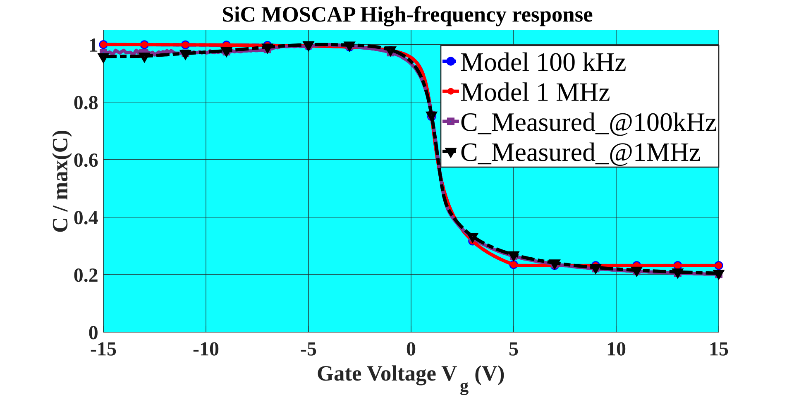
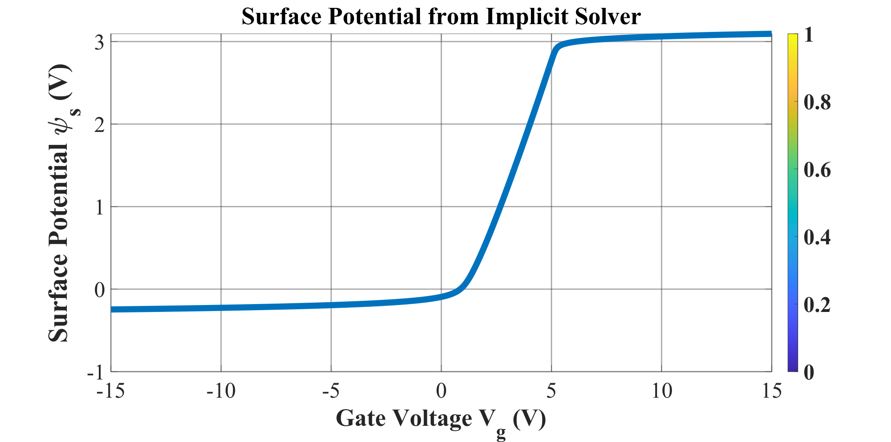

# MOSCAP C-V Model

A modular MATLAB framework for simulating MOS capacitor C-V characteristics with surface-potential physics, Si and 4H-SiC material support, and non-ideal effects such as interface traps, border traps, poly depletion, and series resistance.

## What It Does

- Solves the semiconductor surface potential with a damped Newton method
- Uses a Poisson-Boltzmann charge model for accumulation, depletion, and inversion
- Splits the surface capacitance into two physical limits directly from the surface potential:
  - **Low-frequency** — minority carriers respond (curve recovers toward `Cox`)
  - **High-frequency** — inversion charge is frozen, so the curve saturates at `Cmin`
- Plots everything **normalized as `C/Cox`** so shape is compared independent of area/`tox`
- Includes non-ideal behavior driven by `Dit`, border traps, carrier generation (`tau_gen`), poly depletion, and series resistance
- Compares simulation against measured C-V data and fits SiC parameters to normalized data
- Provides both batch execution and an interactive MATLAB GUI

## Preview of the MOSCAP Visualizer






Video Preview


## Core Equations

Gate-voltage relation:

```text
V_G = V_FB + psi_s - Q_s(psi_s) / C_ox'
```

Flat-band voltage:

```text
V_FB = phi_MS - Q_ox / C_ox'
```

Oxide capacitance density:

```text
C_ox' = epsilon_ox / t_ox
C_ox = C_ox' * A
```

Surface charge:

```text
Q_s(psi_s) = -sign(psi_s) * sqrt(2 * epsilon_Si * q * N_A * V_T * F(psi_s))
```

with:

```text
F(psi_s) = exp(-psi_s / V_T) + psi_s / V_T - 1        (majority: accumulation + depletion)
         + (n_i / N_A)^2 * (exp(psi_s / V_T) - psi_s / V_T - 1)   (minority: inversion)
```

Surface capacitance (Nicollian–Brews two-limit split, computed in `+moscap/surfaceCapacitances.m`):

```text
C_s,LF ∝ |dF/du|          minority carriers respond      (u = psi_s / V_T)
C_s,HF ∝ |dF_maj/du|      inversion charge frozen -> Cmin
```

A generation factor `gen(omega) = 1 / (1 + (omega * tau_gen)^2)` interpolates between the
frozen (HF) and full (LF) limits, so `tau_gen` is the single physical knob for inversion response.

Network + measured capacitance model:

```text
C_total = (C_ox,eff * (C_s + C_it + C_bt)) / (C_ox,eff + C_s + C_it + C_bt) + C_par
C_meas  = C_total / (1 + (omega * R_s * C_total)^2)
```

Normalized display (all plots and the optimizer objective use this):

```text
C/Cox = C_total / C_ox,eff          (model)
C/Cox = C / max(C_accumulation)     (measured)
```

## Material Support

Supported materials:

- Silicon (Si)
- 4H-SiC

Material-dependent properties include:

- dielectric constant
- intrinsic carrier concentration (`ni` for 4H-SiC is ~12 orders of magnitude below Si)
- doping bounds
- generation time (`tau_gen`) defaults — short for Si, long (ms) for SiC

## Main Files

- `main_moscap_app.m`: main entry point
- `+moscap/defaultParameters.m`: default parameter set
- `+moscap/simulateMosCapCV.m`: core solver
- `+moscap/surfaceCapacitances.m`: LF/HF surface-capacitance split
- `+moscap/qsurfaceAndDerivative.m`: Poisson–Boltzmann surface charge
- `+moscap/normalizeCV.m`: C/Cox normalization helper
- `+moscap/launchMosCapGui.m`: interactive GUI
- `+moscap/plotSimulationOnly.m`: static plots
- `+moscap/optimizeSiCParameters.m`: SiC parameter fit to normalized C-V
- `optimize_SiC_CV_fit.m`: end-to-end optimization workflow script
- `verify_simplified_model.m`: regression check (HF saturates at Cmin, no flip-flop)

## Usage

Run the app from MATLAB (from the repo root, so the `+moscap` package is on the path):

```matlab
main_moscap_app        % or the legacy wrapper: capacitor_model
```

Fit SiC parameters to measured normalized C-V:

```matlab
optimize_SiC_CV_fit    % edit the USER CONFIGURATION block for your CSV
```

Diagnostic/analysis scripts live in `diagnostics/`. Run them from the repo root with the root on
the path:

```matlab
addpath(pwd)                          % once per session, from the repo root
run('diagnostics/compare_si_sic.m')
```

## GUI Features

- Material switching between Si and 4H-SiC
- Real-time parameter updates
- Measured data import
- Model vs measurement overlay
- Low-frequency and high-frequency C-V views

## Validation Focus

The validation report checks:

- Newton convergence
- capacitance bounds
- accumulation behavior
- depletion minimum
- measurement consistency
- material-dependent parameter limits

## Notes on SiC Behavior

For 4H-SiC the intrinsic carrier concentration is extremely small, so strong inversion requires
large band bending and the DC surface-potential solve pins `psi_s` near `2·phi_F`. Because the
high-frequency branch freezes the inversion charge, the HF curve saturates at `Cmin` (no recovery
to `Cox`), and with SiC's long `tau_gen` even the low-frequency branch shows little inversion
recovery — the physically expected deep-depletion-like behavior.

## Repository Layout

```text
C_V/
├── main_moscap_app.m          entry point
├── capacitor_model.m          legacy wrapper
├── optimize_SiC_CV_fit.m      optimization workflow
├── verify_simplified_model.m  regression check
├── Readme.md
├── +moscap/                   core package (solver, GUI, IO, optimizer)
│   ├── simulateMosCapCV.m
│   ├── surfaceCapacitances.m
│   ├── qsurfaceAndDerivative.m
│   ├── normalizeCV.m
│   ├── defaultParameters.m / enforceMaterialConsistency.m
│   ├── materialProperties.m / materialNaBounds.m
│   ├── drawCurves.m / plotSimulationOnly.m / launchMosCapGui.m / guiHelpers.m
│   ├── readMeasuredData.m / loadMeasuredDataTemplate.m / getMeasuredCgg.m
│   ├── compareMeasured.m / printModelReview.m / printValidationReport.m
│   ├── optimizeSiCParameters.m / loadParametersFromFile.m / saveParametersToFile.m
│   └── PHYSICS_MODEL.md
├── examples/                  example measured CSVs
├── diagnostics/               standalone analysis/diagnostic scripts
└── docs/                      figures, schematics, references
```

## Requirements

- MATLAB R2021b or newer
- Optimization Toolbox (`fmincon`) for `optimize_SiC_CV_fit.m`; the core model/GUI need no toolboxes

## Authors


##### **Cite Text**

```
@inproceedings{islam2026surface,
  author    = {
    Md Majharul Islam and
    Aireen Amir Jalal and
    Priyam Saha and
    Kevin Chen and
    Zakia Sultana and
    Abu Shahir Md Khalid Hasan and
    Peter Wilson and
    Homer A. Mantooth
  },
  title     = {Surface-Potential-Based Modeling of MOS Capacitors Including Non-Ideal Effects for SiC CMOS Processes},
  booktitle = {2026 IEEE 13th Workshop on Wide Bandgap Power Devices and Applications (WiPDA)},
  year      = {2026},
  publisher = {IEEE}
}
```

Last updated: July 2026
